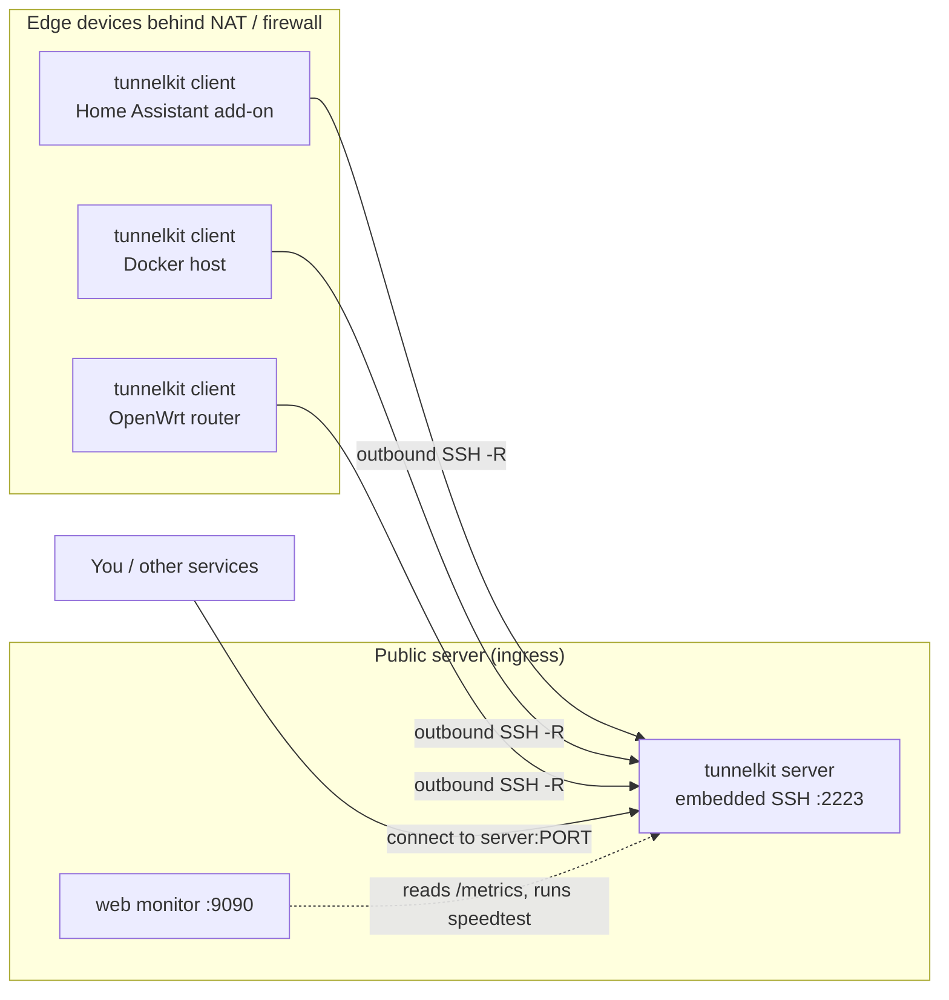
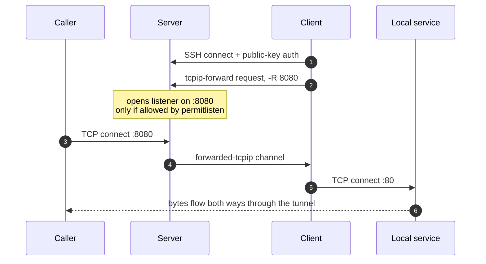
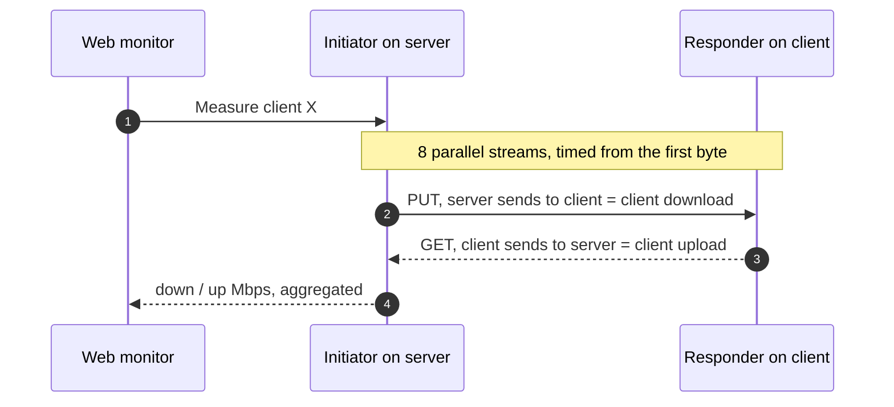

# tunnelkit

A client/server for a **reverse SSH tunnel** to a public server, with a **stats
endpoint** (so a monitor can see traffic, uptime and reconnections) and a
**client↔server speedtest**. A single Go binary (standard library only, no
dependencies), packaged three ways: a **Home Assistant add-on**, a **Docker
image** and an **OpenWrt package**. Everything lives in one monorepo.

> It replaces an `autossh` + hourly-cron workaround: it reconnects on the real
> ssh exit signal (not a monitor port the server rejects), with
> `ExitOnForwardFailure`, sane keepalives, `boot: auto` and a built-in watchdog.

> **Documentation:** [docs/](docs/README.md) has a getting-started guide, operations
> (backups, adding/revoking clients, upgrades), key rotation and troubleshooting.

## Layout

```
tunnelkit/
├── core/          Go code: cmd/client and cmd/server + shared internal/
├── tunnelkit-client/  Home Assistant add-on (uses the CI image via image:)
├── docker/        plain image + compose (client)
├── openwrt/       Makefile (.ipk) + procd init + uci
├── server/        server side: tunnel server + speedtest + web monitor
├── docs/          guides: getting started, operations, key rotation, troubleshooting
└── .github/       CI: multi-arch images → GHCR + OpenWrt binaries
```

A **single image/binary** from CI feeds all three packagings.

## The binary

```
tunnelkit client      # reverse SSH tunnel + /metrics + speedtest responder
tunnelkit speedtest   # initiator: measures a client THROUGH THE TUNNEL (run on the server)
tunnelkit responder   # standalone speedtest responder (host with no tunnel)
```

**The speedtest is always client↔server through the tunnel**: the client starts
the responder and forwards it with `-R speedtest_forward_port`; the server
(initiator) measures against `tunnelkit-server:<that port>`, so what is measured
is the real tunnel throughput, and it is triggered from the server.

Configuration comes from **flags**, **`TK_*` environment variables** or
**`/data/options.json`** (Home Assistant add-on), in that order of priority.

## How it works

### Topology

Edge devices sit behind NAT or a firewall, so they **dial out** to the public
server and ask it to open ports on their behalf (SSH reverse forwarding). Anyone
who can reach the server then reaches the edge service through the tunnel — no
inbound port on the edge, no public IP needed.



### One reverse tunnel, step by step

Each `-R` forward turns a port on the **server** into a doorway to a service on
the **client**. The server only opens a port a key is allowed to (`permitlisten`),
and traffic is counted as it is piped.



The client also forwards two extra ports the server uses for observability: its
`/metrics` endpoint (`stats_forward_port`) and the speedtest responder
(`speedtest_forward_port`).

### Speedtest through the tunnel

The panel triggers the **initiator** on the server, which measures against the
**responder** on the client. A single stream over a high-latency link is capped
by the SSH channel window divided by the round-trip time (the bandwidth–delay
product), not by the link itself — so the initiator opens **8 parallel streams**
to fill the link, like a real speedtest.



## Releases and image verification

Releases are tagged `vX.Y.Z`. Each one publishes `tunnelkit-client` and
`tunnelkit-server` images tagged `X.Y.Z`, `X.Y` and `latest`, plus the OpenWrt
client binaries and a `SHA256SUMS` file on the GitHub release. In production,
pin an exact `X.Y.Z` tag (`main` publishes `edge`, which moves on every push).

Images are signed with [cosign](https://github.com/sigstore/cosign) (keyless,
from this repository's workflow) and carry an SBOM and build provenance:

```bash
cosign verify ghcr.io/adriansanchis87/tunnelkit-server:X.Y.Z \
  --certificate-identity-regexp '^https://github.com/adriansanchis87/tunnelkit/\.github/workflows/build\.yml@refs/tags/v' \
  --certificate-oidc-issuer https://token.actions.githubusercontent.com

docker buildx imagetools inspect ghcr.io/adriansanchis87/tunnelkit-server:X.Y.Z \
  --format '{{ json .SBOM }}'
```

## Usage

All examples use placeholder values: a server reachable at `example.com`, an SSH
login `tunnel`, and a tunnel SSH port `2223`.

### Client (Docker)

Run the client and forward a local service (e.g. a web app on `:80`) to
port `8080` on the server:

```bash
docker run -d --name tunnelkit-client \
  --restart unless-stopped \
  --network host \
  -v ~/.ssh/id_ed25519:/keys/id_ed25519:ro \
  -e TK_HOST=example.com \
  -e TK_SSH_PORT=2223 \
  -e TK_USER=tunnel \
  -e TK_KEY_FILE=/keys/id_ed25519 \
  -e TK_FORWARDS="8080:localhost:80" \
  -e TK_STATS_FORWARD_PORT=8048 \
  -e TK_SPEEDTEST_FORWARD_PORT=8047 \
  ghcr.io/adriansanchis87/tunnelkit-client:latest
```

`TK_FORWARDS` is comma-separated for multiple `-R` forwards, e.g.
`"8080:localhost:80,8081:localhost:80"`. `TK_STATS_FORWARD_PORT` exposes the
client's `/metrics` to the server (0 = off) and `TK_SPEEDTEST_FORWARD_PORT`
exposes the speedtest responder (0 = off).

### Client (binary / flags)

The same thing with the raw binary:

```bash
tunnelkit client \
  --host example.com --ssh-port 2223 --user tunnel \
  --key ~/.ssh/id_ed25519 \
  --forwards 8080:localhost:80 \
  --stats-forward 8048 --speedtest-forward 8047
```

### Pinning the server key (recommended)

By default the client trusts the server's SSH host key the first time it sees it
(trust on first use). Whoever can intercept that first connection could
impersonate the server. To prevent it, give the client the server's public key:

1. Start the server and read its startup log:
   `tunnelserver: to pin this server on clients set TK_HOST_KEY="ssh-ed25519 AAAA..."`
   (the key is the public part of `host_key`; keep that file safe and backed up,
   because if it is regenerated every pinned client will refuse the server).
2. Set it on each client: `TK_HOST_KEY`, `--host-key`, the add-on option
   `host_key` or the UCI option `host_key`.

With a pinned key, any other key makes the client refuse to connect (OpenSSH:
`REMOTE HOST IDENTIFICATION HAS CHANGED`; Dropbear: `host key mismatch`) and keep
retrying; an invalid `host_key` is reported at startup. Works with both SSH
backends. Leaving it empty keeps the old behaviour.

### Server

Bring up the tunnel server (embedded Go SSH server, no external ssh daemon).
From `server/` (or `docker/`):

```bash
docker compose -f server/docker-compose.yml up -d
```

Key settings (see `server/docker-compose.yml`):

- `TK_SERVER_SSH_ADDR=:2223` — where the embedded SSH server listens.
- `TK_SERVER_MONITOR_ADDR=:9090` — web monitor panel (empty = off).
- `TK_SERVER_HOST_KEY=/data/host_key` — host key, created on first run.
- `TK_SERVER_AUTHORIZED_KEYS=/data/authorized_keys` — allowed public keys.
- `TK_SERVER_TRAFFIC_FILE=/data/traffic.json` — per-port/per-day traffic
  persistence.
- `TK_SERVER_CLIENTS=/data/clients.json` (optional) — titles, port names and
  expected URLs shown in the panel; see [Naming clients and ports](#naming-clients-and-ports).
- `TK_SERVER_LINKS` (optional) — web links the panel shows per client, for
  clients named `tk-<site>-<role>`. A `role=template` list with `{site}` /
  `{role}` placeholders, giving the **subdomain label** of that client's main
  service under the panel's own domain. Example:
  `TK_SERVER_LINKS="web=web{site},ssh=ssh{site}"` links `tk-home-web`
  to `webhome.<panel domain>` and `tk-home-ssh` to
  `sshhome.<panel domain>`. Requests arriving at the monitor with that
  host label are reverse-proxied to the client's lowest forwarded port. Empty
  (default) = no links, no host-based proxying.
- `TK_SERVER_LINK_BACKUP_SUFFIX` (optional, e.g. `-b`) — also offer, for each
  client, a **backup** link to the sibling client of the same site (other
  role) reached through this one, at `<sibling label><suffix>`. Useful when
  two devices at a site (e.g. an application server and its router) forward
  each other's SSH/web as a fallback.

The `/data` volume holds `host_key`, `authorized_keys` and `traffic.json`.

### Troubleshooting

See [docs/troubleshooting.md](docs/troubleshooting.md): why a client will not
connect (`/api/status` diagnosis, handshake failures, the client's pre-flight
probe), the optional UDP heartbeat that tells a broken TCP path from a dead link,
and how the server frees ports after dirty client drops.

### Naming clients and ports

By default the panel shows each client by its key comment (`tk-site1-web`) and its
ports as bare numbers. An optional `clients.json` next to `authorized_keys` gives
them readable names and, optionally, the URL each service is expected to answer on:

```json
{
  "tk-site1-web": {
    "title": "Site 1 - web server",
    "ports": {
      "8080": { "name": "Web UI", "url": "https://web.site1.example.com" },
      "8048": { "name": "Metrics" }
    }
  }
}
```

- `title` replaces the client name in the table (the technical name stays visible
  under it). `ports` maps a port number to a `name` and an optional `url`.
- It is presentation only: **access control stays in `authorized_keys`**. A port not
  listed here is still shown, by number.
- The file is re-read when it changes. A syntax error keeps the previous contents
  and is logged; invalid entries (bad port, non-`http(s)/tcp/ssh` URL, over-long
  text) are ignored and logged once.
- Clicking **ON** on a client row opens a dialog with its ports: name, expected URL
  (clickable when it is `http` or `https`) and a **Test** button. Test checks the
  port *through the tunnel*, from the server: with an `http(s)` URL it requests that
  URL (Host header and TLS name taken from the URL, certificate not verified) and
  reports the HTTP status and latency; without one it opens a TCP connection and
  tells apart "service up", "held open waiting for the client to speak" and "the
  tunnel closed it at once, so the client cannot reach its local service". Only
  ports the client currently forwards can be tested, and each port at most once a
  second.

### Monitor panel

When `TK_SERVER_MONITOR_ADDR` is set, the server serves a web UI at that address
(e.g. `http://example.com:9090`). It shows per-client status (connected,
uptime, reconnections, last error), traffic with a per-port and per-day
breakdown, and a speedtest button. The speedtest runs client↔server through the
tunnel using 8 parallel streams, so it reports the real tunnel throughput.

### OpenWrt

Install the package and configure it via UCI:

```bash
opkg install tunnelkit_0.2.1-1_<arch>.ipk
# edit /etc/config/tunnelkit
/etc/init.d/tunnelkit enable
/etc/init.d/tunnelkit start
```

`/etc/config/tunnelkit` mirrors the client options (`host`, `ssh_port`,
`username`, `key_file`, `remote_forwarding`, `stats_forward_port`,
`speedtest_forward_port`). The `ssh_impl` option selects the SSH backend:

- `option ssh_impl 'dropbear'` — uses the SSH client already in the OpenWrt
  base. Dropbear has a small SSH channel window that limits throughput on
  high-latency links.
- `option ssh_impl 'openssh'` — much better throughput on high-latency links,
  but needs the `openssh-client` package and an OpenSSH-format private key.

**Tiny-flash routers** that cannot store the ~6 MB binary in flash can run it
from `/tmp` (RAM) and re-download it on every boot. Keep the key in flash
(`/etc/tunnelkit/id_*`, it persists) and set:

```
option binary '/tmp/tunnelkit-client'
option binary_url 'https://github.com/OWNER/tunnelkit/releases/download/vX.Y.Z/tunnelkit-client-<arch>'
```

The service fetches the binary with `uclient-fetch` on start if it is missing.
Prebuilt static binaries per architecture are attached to each GitHub release.

### Home Assistant add-on

In Home Assistant go to Settings → Add-ons → Store → ⋮ → Repositories and paste
this repo's URL. The **TunnelKit Client** add-on appears; install it and set the
options (host, username, key file, remote forwarding, etc.) from the add-on
configuration tab. It runs with `boot: auto` and a watchdog, so the Supervisor
restarts it if it dies. See `tunnelkit-client/DOCS.md` for the full option list.

## Status

Builds and cross-compiles (amd64, arm64, armv7, mips) and works: tunnel,
`/metrics` and speedtest are all tested.

MIT.
